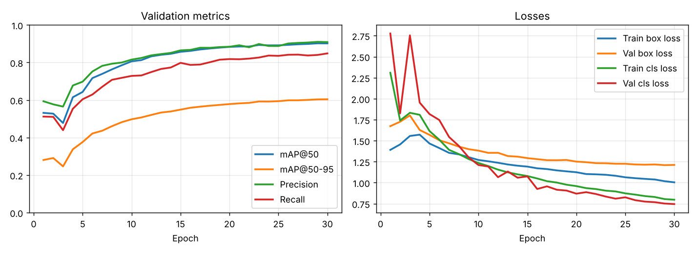

# RiskRadar AI – Weapon Detection Model

A YOLOv8 object detection model that detects weapons (guns and knives) in images and CCTV-style frames. It is one of the five specialised models inside **RiskRadar AI**, a team project that analyses street scenes and gives each scene an overall risk score.

I designed and built this model end to end: dataset collection, cleaning and preprocessing, training, evaluation and iterative improvement.

## Results

Validation results on 2,066 held-out images (2,091 labelled weapons), after 30 training epochs:

| Metric | Score |
| --- | --- |
| mAP@50 | **90.2%** |
| mAP@50-95 | 60.4% |
| Precision | 90.9% |
| Recall | 84.9% |



### Real-world robustness test

To check how the model behaves outside the validation set, I ran it on **637 external images** and manually counted the weapons in each one, then compared my counts with the model's predicted counts:

| Metric | Score |
| --- | --- |
| Mean Absolute Error (MAE) | **0.34** weapons per image |
| Mean Squared Error (MSE) | 0.52 |

On average the predicted count is off by about one third of a weapon per image.

## How it fits into RiskRadar AI

RiskRadar AI runs five detection models on a street scene: weapons, violence, fire, crowd counting and face masks. Their outputs are combined into features and passed to a machine learning classifier that labels the scene as **safe** or **potentially dangerous**. This repository contains the weapon detection part, which was my responsibility in the team.

## Model and training setup

| Setting | Value |
| --- | --- |
| Framework | Ultralytics YOLOv8 |
| Model | YOLOv8n (3.0M parameters, 8.2 GFLOPs) |
| Task | Object detection, 1 class (`weapon`) |
| Starting point | COCO-pretrained YOLOv8n weights (transfer learning) |
| Image size | 640 × 640 |
| Batch size | 16 |
| Epochs | 30 of a planned 40 (early stopping patience: 10) |
| Training environment | Google Colab, NVIDIA Tesla T4 GPU (~10 min per epoch) |

Training stopped during epoch 31 when the Colab session ended, so the epoch-30 checkpoint is the final model. Validation metrics had already levelled off by then (see the curves above).

The full training and evaluation code is in [`notebooks/weapon_detection_training.ipynb`](notebooks/weapon_detection_training.ipynb), the configuration in [`config/args.yaml`](config/args.yaml) and the per-epoch metrics in [`results/results.csv`](results/results.csv).

## Dataset

- **26,280 training images** and **2,066 validation images**, plus a separate test split.
- Handguns, rifles, shotguns and knives, including CCTV-style and real-world scenes, labelled with bounding boxes. About 4,600 training images are backgrounds with no weapons, to reduce false alarms.
- Collected, cleaned and versioned with Roboflow, then exported in YOLOv8 format. The label distribution is shown in [`results/label_distribution.jpg`](results/label_distribution.jpg).
- The dataset itself is not included in this repository because of its size and image licensing.

## Repository structure

```
riskradar-weapon-detection/
├── README.md
├── notebooks/
│   └── weapon_detection_training.ipynb   # data download, training, evaluation
├── config/
│   └── args.yaml              # training configuration
├── results/
│   ├── results.csv            # metrics per epoch
│   ├── training_curves.png    # metrics and loss curves
│   └── label_distribution.jpg
└── weights/
    └── best.pt                # trained model weights
```

## Usage

```bash
pip install ultralytics
```

```python
from ultralytics import YOLO

model = YOLO("weights/best.pt")
results = model.predict("your_image.jpg", conf=0.5)
results[0].show()
```

## Tech stack

Python · Ultralytics YOLOv8 · PyTorch · OpenCV · Roboflow · pandas · scikit-learn · Google Colab

## Author

**Besan Aldhesat** – Data Science & AI student, Mutah University
[LinkedIn](https://linkedin.com/in/besan-aldhesat-271666329) · [GitHub](https://github.com/besan05)
